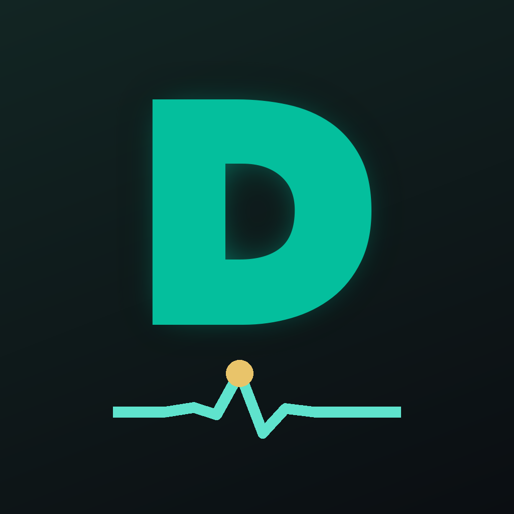
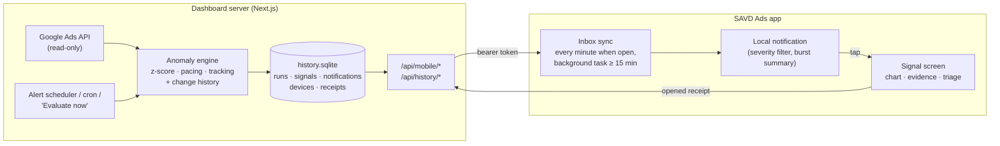

<p align="center"></p>

# SAVD Ads — the Google Ads dashboard in your pocket

**SAVD Ads** is the React Native app (iOS and Android, in [`mobile/`](mobile)) for the SAVD Google Ads dashboard in this
repository. It shows the account's numbers on the phone and, above all, **taps you on the shoulder when something is
wrong**: a CPA that doubled overnight, a conversion tag that stopped firing, a campaign burning through its budget by
noon. The web dashboard finds the anomaly; the phone makes sure a person hears about it while it still matters.

Everything stays **read-only** for Google Ads: the app can't pause a campaign or change a bid, so nothing on the phone
can break an account.

---

## Why notifications on the phone

An anomaly costs money for every hour nobody looks at it. Dashboards are visited when someone remembers to, usually on
the next working day; a broken tracking tag or a runaway campaign keeps spending until then. The anomaly engine judges
**settled days** (data through yesterday, compared with a baseline), so it finds problems the morning after. The phone is
what turns "found" into "someone knows".

| Without the app | With the app |
|---|---|
| **Friday afternoon:** a site release breaks the conversion tag. Smart Bidding sees no conversions and starts bidding blind. | **Friday afternoon:** same release, same broken tag. |
| **Weekend:** the account keeps spending with no conversions recorded. | **Saturday ~07:00:** the first scheduled evaluation after Friday closes flags the drop: **Critical · Conversions down**. The account manager's phone buzzes. |
| **Monday 09:30:** someone opens the dashboard, notices the drop and starts digging. | One tap opens the signal: what moved, against which baseline, which account change most likely caused it, and what to do next. The tag is fixed or the campaign paused in Google Ads that morning. The signal is marked *Acknowledged* from the phone, so the team sees it is in hand. |
| About 2.5 days of spend wasted, and Smart Bidding has to relearn. | A few hours. |

The point isn't more alerts, it's **shorter time-to-awareness**. The history database measures this directly. For each
account it shows how long signals stayed open (median and slowest 10 % time to resolve), and whether phone notifications
were seen (delivered, opened, open rate, median minutes to open). After a few weeks you can compare those numbers with
the weeks before phones were connected.

### Comfortable by design

Apps that alert too much soon get muted. These rules keep this one worth keeping on:

- **Only what you asked for.** Each phone picks *Warning + Critical* or *Critical only*, and whether it wants
  opportunities too (ROAS up, CPA down). The setting is kept on the phone and on the server.
- **No notification storms.** If several signals arrive at once, the phone shows one summary, for example
  "4 critical of 6 new signals · Acme Running Co.", instead of buzzing six times.
- **No backlog replay.** A fresh install or a new sign-in starts at the newest item. You never get a pile of old alerts.
- **Closure, not just alarms.** When a problem clears, a quiet *Back to normal* notice comes on a low-importance channel,
  so you know you can stop worrying.
- **Sound only for critical.** On Android, critical signals have their own high-importance channel. Warnings arrive
  silently, and resolved notices on a low-importance channel.
- **One tap to context.** A notification opens the signal itself: the summary, a chart of the metric with the expected
  range shaded, the evidence, the change-history verdict ("Likely cause: final URL changed on Oct 15"), and the
  recommended next step.
- **Triage from anywhere.** *Acknowledge*, *Snooze 24 h* and *Resolve* are shared with the web dashboard and with
  colleagues (if your role allows it).
- **Honest about demo data.** Before Google Ads is connected, the whole stack runs on generated demo accounts. Every
  screen and every notification says *Demo*.

---

## How it works



1. **Detection (server).** The anomaly engine evaluates each account on the alert scheduler
   (`ALERTS_SCHEDULER_ENABLED=true`), from an external cron (`/api/cron/alerts`), or when someone presses *Evaluate now*.
2. **Memory (server, SQLite).** Every evaluation is written to the history database (`src/lib/server/history`):
   - the run;
   - every signal, with its peak severity, how often it was seen and when it was resolved;
   - each per-run observation;
   - a notification row for each new, escalated or resolved signal.

   Live and demo records are tagged and never mixed.
3. **Delivery (phone).** The app reads its inbox (`GET /api/mobile/notifications?since=<cursor>`) with a bearer token:
   - right away;
   - every minute while it is open;
   - when it returns to the foreground;
   - in the background through `expo-background-task` (Android WorkManager, iOS BGTaskScheduler).

   New items become local notifications. Fetching counts as *delivered*, and tapping sends an *opened* receipt.
4. **Analysis.** `GET /api/history/summary` turns the stored records into the long-term view the app shows on its
   **History** tab, and the web shows on *Data source → Warehouse*: signals per month by severity, recurring campaigns and
   metrics, time to resolve, and notification reach.

The inbox is **pull-based**, so it works today with no Apple Push (APNs) or Firebase (FCM) credentials. Each device row
already has a `push_token` column. Remote push can later wake the same sync instantly, for alerts that can't wait for the
next background slot.

---

## The app

| Tab | What it shows |
|---|---|
| **Overview** | Account switcher. 7D / 14D / 30D / MTD. Spend, conversions, CPA, ROAS, clicks and CTR against the previous period (computed as ratios of sums by the server's query engine). Spend and conversions per day as two separate charts, since the dashboard never uses dual axes. Month pacing (spent, projected, budget). The open signals. |
| **Signals** | Every signal in the current window, filterable by status and severity. Each one opens a detail screen with the trend chart, evidence, change-history verdict, recommendation and the triage actions. |
| **History** | The long-term view from SQLite: signals per month, time to resolve, phone notification reach, recurring campaigns, latest stored signals. |
| **Settings** | Notification permission. On/off. Minimum severity. Opportunities. *Check now*. A test notification. Account, sign-out, and a link to open the web dashboard. |

**Stack:**
- Expo SDK 54 (React Native 0.81, New Architecture) and Expo Router.
- `expo-notifications`, `expo-background-task`, `expo-secure-store` (the token and settings live in the iOS Keychain or
  Android Keystore).
- `react-native-svg` for the charts.
- SAVD colours, light and dark.

SDK 54 is the newest Expo SDK that builds with Xcode 16, which is what this Mac has.

### Sign-in and security

- **Same accounts as the web dashboard.** `POST /api/auth/mobile/login` uses the same password check, lockout and 2FA
  as the web form. With 2FA on, it answers with a challenge for `POST /api/auth/mobile/mfa`.
- **Bearer token, not a cookie.** The session token comes back in the response body and is sent as
  `Authorization: Bearer`, so there is no cookie to abuse from another site.
- **A normal, revocable session.** The session has method `mobile`. It lasts 30 days and ends after 14 idle days
  (`AUTH_MOBILE_SESSION_DAYS`, `AUTH_MOBILE_IDLE_DAYS`). Revoke it from *Account → Sessions* on the web, or by signing
  out on the phone (`POST /api/auth/mobile/logout`).
- **Same access rules as the web.** Client users only ever see their own client's accounts and notifications, and
  self-registered users without access get nothing until an admin assigns them.
- **No DASHBOARD_BASIC_AUTH.** The app can't send the extra Basic-auth header, so leave that variable unset on servers
  the app talks to. The dashboard's own sign-in still protects everything.

---

## Run it

### 1. The server

```bash
npm install
npm run dev            # http://localhost:3000 — demo accounts until Google Ads keys are in .env
```

To have the phone notified without anyone pressing *Evaluate now*, set these in `.env`:

```bash
ALERTS_SCHEDULER_ENABLED=true   # evaluate on a timer (or call /api/cron/alerts with CRON_SECRET)
ALERTS_INTERVAL_MINUTES=30
HISTORY_ENABLED=true            # default; the history file is data/history/history.sqlite
HISTORY_RETENTION_DAYS=0        # 0 keeps everything; signals are always kept
```

Requirements:
- Node.js 22.13 or later, for the built-in `node:sqlite`.
- Phones reach the server by its LAN address, for example `http://192.168.1.4:3000`. iOS allows local addresses
  (`NSAllowsLocalNetworking`). A release Android build needs **https**.

### 2. The app

The app uses native modules (notifications, background tasks, secure storage), so it runs as a development build, not
in Expo Go:

```bash
cd mobile
npm install
npx expo run:ios       # builds, installs on a simulator and starts Metro
npx expo run:android   # needs the Android SDK
```

Sign in with the dashboard address, your email and your password.

### 3. Release builds

```bash
cd mobile
npm run build:ios      # → dist/SAVDAds.app, Release build for the iOS Simulator (arm64, no signing)
npm run build:android  # → dist/savd-ads.apk, release APK (arm64-v8a), needs ANDROID_HOME
```

What the build scripts do:
- generate the native projects with `expo prebuild` when they are missing (`ios/` and `android/` are generated, never
  edited by hand: configure them in `app.json`);
- build arm64 only;
- delete the intermediate build folders afterwards to save disk space (`KEEP_BUILD=1` keeps them).

For the stores:
- **iOS:** open `ios/SAVDAds.xcworkspace` in Xcode, choose a signing team and *Product → Archive*. Since April 28, 2026,
  App Store uploads must be built with Xcode 26 or later.
- **Android:** add an upload key and a release `signingConfig`. Build an App Bundle with `./gradlew bundleRelease`.

> **Build status on this machine:**
> - **iOS** builds with Xcode 16.2.
> - **Android** was not built here. The Android SDK isn't installed and was skipped on purpose to save disk space.
>   `npm run build:android` works on any machine with the SDK.
> - Nothing has been run on a simulator, emulator or device yet.

---

## API used by the app

| Endpoint | Purpose |
|---|---|
| `POST /api/auth/mobile/login` · `/mfa` · `/logout` | Sign in, with optional 2FA, and get or revoke a bearer token. Registers the device. |
| `GET /api/mobile/overview?range=` | KPIs vs the previous period, daily series, pacing and open signals in one call. |
| `GET /api/mobile/notifications?since=&limit=` | The device's notification inbox (visible accounts only, device filters applied). |
| `POST /api/mobile/notifications/ack` | Delivered or opened receipts. |
| `GET` / `PUT /api/mobile/device` | This device's notification settings (and a future push token). |
| `GET /api/history/summary?months=&scope=` · `/api/history/signals` | Long-term analysis from SQLite. |
| `GET /api/history/status` | Database file, size, schema and row counts (admins). |
| `GET /api/anomalies`, `GET` / `PATCH /api/anomalies/{id}` | Signals and triage, shared with the web dashboard. |

## History database (SQLite)

| Table | One row per |
|---|---|
| `evaluation_run` | anomaly evaluation of one account (mode, data-through date, counts) |
| `signal` | signal ever raised: entity, metric, severity now and at peak, first/last seen, resolved at, observations |
| `signal_observation` | signal per run (severity and numbers drift while it stays open) |
| `notification` | new / escalated / resolved event, with phone-sized title and body |
| `mobile_device` | signed-in phone: platform, settings, push token, last seen |
| `notification_receipt` | notification × device: delivered at, opened at |

The schema uses append-only numbered migrations (`src/lib/server/history/schema.ts`), WAL mode, and runs on Node's
built-in SQLite. Retention (`HISTORY_RETENTION_DAYS`) trims runs and notifications and keeps the signals. Google Ads
facts themselves live in the separate warehouse (`data/warehouse/live.sqlite`), which only ever stores live data.

## Repository

```
mobile/                    React Native app (Expo): src/app = screens (Expo Router), src/lib = API, session,
                           notifications, background sync, theme; scripts/ = release builds
src/lib/server/history/    SQLite history: schema, repo, recording evaluations, summaries
src/lib/server/mobile/     mobile sign-in, overview, notification inbox
src/app/api/{mobile,history,auth/mobile}/   the endpoints above
src/                       the web dashboard (Next.js 16, TypeScript): overview, campaigns, budget, anomalies, explore…
tests/unit/                vitest (npm run verify = lint + typecheck + tests)
```
