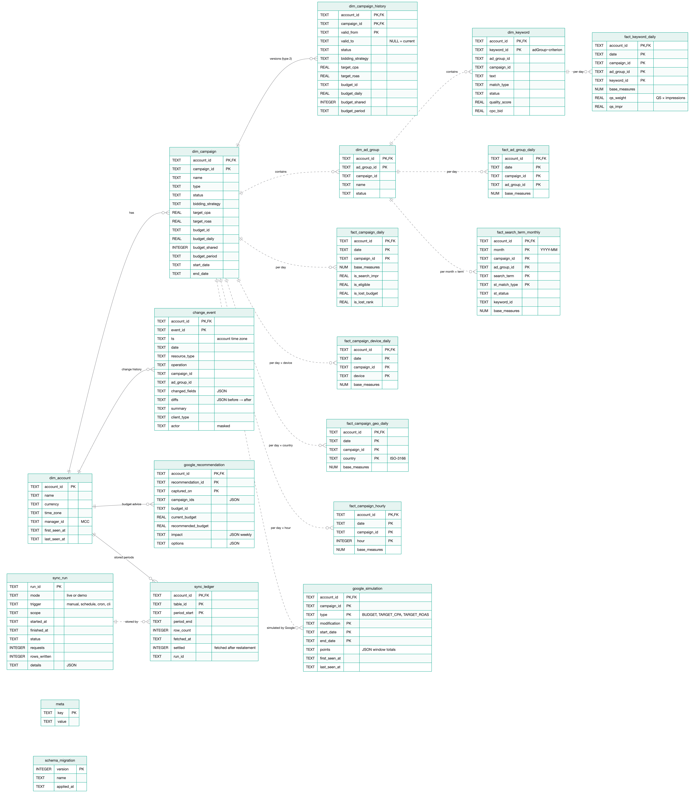
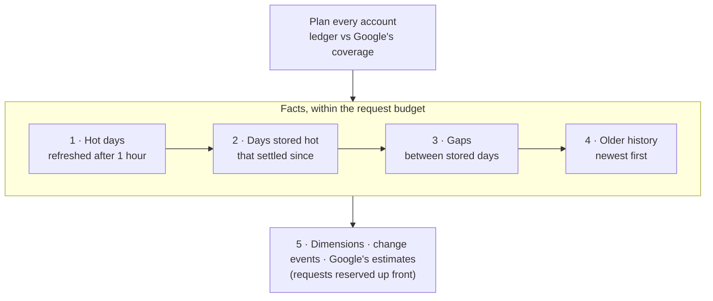

# Analytics warehouse: database design (SQLite)

SAVD Ads Intelligence keeps the Google Ads data it reads in a local **SQLite** database, the *analytics warehouse*. Once a day is stored and settled, the dashboard reads it from the warehouse instead of asking Google again, and the history stays after Google stops serving it. This document describes why the warehouse exists, its tables, how the dashboard reads it, how syncs fill it, and how to run it. For the user steps (the **Data source → Warehouse** tab), see [Step 29 of the user guide](USER-GUIDE.md#step-29-keep-long-term-data-in-the-warehouse).

The warehouse is **read-only towards Google Ads**, like the rest of the application: it only uses the same `search` / `searchStream` reports.

## 1. Why a warehouse

The Google Ads API only keeps recent history for some reports, and every request counts against the daily quota of the Google Cloud project (Explorer access: 2,880 operations a day).

| Data | What Google Ads still serves | What the warehouse keeps |
|---------------------------|---------------------------|------------------------------------------|
| Daily facts (campaign, device, country, ad group, keyword) | 37 months | Every day it has stored (optional limit: `WAREHOUSE_RETENTION_DAYS`) |
| Hourly data | 92 days | Every day it has stored |
| Search terms | 12 months, as totals for a period | One row per term and month |
| Change history (`change_event`) | 30 days | Every event it has seen |
| Google's simulations and budget recommendations | The current ones only | Snapshots by simulation window and by day |
| Campaign settings (status, bidding, budget) | The current values only | A type-2 history (one row per version) from the first sync |

Other benefits:

- **Fewer API requests.** A settled day (one that left the 14-day restatement window, see section 5) never changes again, so it is read locally from then on. The earlier in-memory cache was lost on every restart.
- **Long ranges.** Explore, widgets, year-over-year comparisons and seasonal budget plans can use history that Google no longer serves.
- **Analysis outside the app.** SQL views give monthly totals that SQL tools and BI tools can read from a copy of the file.

## 2. Why SQLite (for now)

- **Built into Node.js** (`node:sqlite`, Node.js 22.13 or later): there is no database server and no native package to install. The application already runs as a single instance with a data folder (`DATA_DIR`, the `/app/data` volume in Docker), and the warehouse is one file in that folder.
- **One file per data mode:** `DATA_DIR/warehouse/live.sqlite` for real accounts and `demo.sqlite` for demo data, so demo rows never mix with an account's real history.
- **WAL mode:** readers never block the single writer.
- **Graceful when unavailable.** If Node.js is older than 22.13, or the folder can't be written, the warehouse switches itself off. The **Warehouse** tab says why, and the application keeps working as before.

Limits: SQLite has one writer at a time, its calls run on the server thread (very large writes, such as years of keyword data, take a moment), and the file is local to one instance. The schema is designed to move to PostgreSQL when the application runs on several instances (section 8).

## 3. Data flow


*Figure 1. The live source (or the demo generator) feeds the WarehouseSource, which reads settled days from SQLite; syncs fill SQLite within a request budget.*

## 4. Schema

The full diagram is [`DATABASE-DIAGRAM.png`](../../DATABASE-DIAGRAM.png) at the repository root (source: [`DATABASE-DIAGRAM.mmd`](../../DATABASE-DIAGRAM.mmd); render with `npm run docs:diagrams`). The tables are created by numbered migrations in `src/lib/server/warehouse/schema.ts` (schema version 1).



*Figure 2. The whole schema. Solid lines are enforced foreign keys, dashed lines are logical links (zoom in, or open the PNG).*

**Conventions**

- **IDs** are `TEXT`: Google IDs are 64-bit integers, and keyword IDs are `adGroupId~criterionId`.
- **Days** are civil dates `YYYY-MM-DD` in the account's time zone. Timestamps are ISO 8601 UTC.
- **Money** is in the account currency (Google's micros ÷ 1,000,000).
- **JSON** goes in `TEXT` columns: diffs, simulation points, recommendation impact.
- **Fact tables** are `WITHOUT ROWID`, clustered on account → date → key (the order every read uses). They are not `STRICT`, so a measure keeps exactly the number the source returned. Dimension and bookkeeping tables are `STRICT`.
- **`account_id`** is in every table and references `dim_account` with `ON DELETE CASCADE`, so deleting one account removes everything stored for it. Facts don't reference the campaign tables: a removed campaign's rows can arrive before its name does.

### 4.1 Dimensions


*Figure 3. Accounts, campaigns with their settings history, ad groups and keywords.*

| Table | One row per | Notes |
|---------------------------|---------------------------|------------------------------------------|
| `dim_account` | Google Ads account | Name, currency, time zone, manager (MCC); first and last time seen |
| `dim_campaign` | Campaign | Latest name, type, status, bidding strategy and targets, budget (daily amount, shared or not, period), start and end. Removed campaigns stay, with their last known name |
| `dim_campaign_history` | Version of a campaign's settings | Type 2: `valid_from` / `valid_to` (NULL = current) for status, bidding strategy, target CPA/ROAS, budget ID, daily budget, shared flag and period. A sync adds a version when one of them changed (on the account's date) |
| `dim_ad_group` | Ad group | Campaign, name, status |
| `dim_keyword` | Keyword | Ad group, campaign, text, match type, status, Quality Score and its parts, CPC bid |

### 4.2 Facts


*Figure 4. Fact tables: one row per account × day (search terms: × month) × key. `base_measures` = impressions, clicks, cost, conversions, conversion value.*

| Table | Key after `account_id` | Measures |
|---------------------------|---------------------------|------------------------------------------|
| `fact_campaign_daily` | date, campaign | Base measures + impression share parts (`is_search_impr`, `is_eligible`, `is_lost_budget`, `is_lost_rank`; NULL when Google returned none) |
| `fact_campaign_device_daily` | date, campaign, device | Base measures |
| `fact_campaign_geo_daily` | date, campaign, country (ISO 3166) | Base measures |
| `fact_campaign_hourly` | date, campaign, hour | Base measures |
| `fact_ad_group_daily` | date, campaign, ad group | Base measures |
| `fact_keyword_daily` | date, campaign, ad group, keyword | Base measures + `qs_weight` (Quality Score × impressions) and `qs_impr`, so average Quality Score is a ratio of sums |
| `fact_search_term_monthly` | month, campaign, ad group, term, match type | Base measures + status and keyword. Google reports search terms as totals for a period, so the warehouse keeps whole calendar months (up to 5,000 terms by cost per month) |

Child tables add up exactly to `fact_campaign_daily` for the same campaign and day, as in the rest of the application.

### 4.3 Change history, Google's estimates and sync bookkeeping


*Figure 5. Change events, Google's simulations and recommendations, and the sync tables.*

| Table | One row per | Notes |
|---------------------------|---------------------------|------------------------------------------|
| `change_event` | Change event | Time (account time zone), resource type, operation, campaign or ad group, changed fields and before → after values (JSON), summary, client type, actor (masked email, as shown in the app) |
| `google_simulation` | Campaign × type × modification × window | Budget, target CPA and target ROAS simulations; `points` keeps Google's window totals (JSON). A window seen again updates `last_seen_at` |
| `google_recommendation` | Recommendation × day | Daily snapshot of the current and recommended budget, the options and Google's weekly impact estimate |
| `sync_run` | Sync | Mode, trigger (Sync now, timer, cron, CLI), scope, status, accounts, requests, rows written, whether the request budget ran out, notes |
| `sync_ledger` | Account × table × stored day (search terms: × month) | Rows, when it was fetched, **settled** (fetched after the restatement window), which sync stored it (NULL = stored while reading) |
| `meta`, `schema_migration` | Key / version | Warehouse metadata (creation time, mode, demo dataset) and applied migrations |

### 4.4 Views for analysis

`v_account_monthly` (per account and month) and `v_campaign_monthly` (per campaign and month, with the campaign's name and type) sum the base measures and compute CTR, CPC, CPA and ROAS as **ratios of sums**, returning NULL when the denominator is 0 (the same rule as the application's query engine).

## 5. How the dashboard reads it

The warehouse wraps the Google Ads source (`WarehouseSource`, `src/lib/server/warehouse/source.ts`). Every widget, Explore question, anomaly check, budget page and AI answer goes through it without knowing it is there.

- **Settled stored day** → read from SQLite. A day is *settled* when it was fetched after leaving the restatement window (`GOOGLE_ADS_RESTATEMENT_DAYS`, 14 by default), because conversions can still be added to recent days.
- **Recent (hot) days and missing days** that Google still serves → fetched from Google as before. Days outside the restatement window are **written through**, so the next read is local.
- **Days Google no longer serves** → read from SQLite. Coverage reports the stored days, so a range beyond Google's window works and the "data is available from …" note moves back.
- **Change history** (live mode): events from Google (last 30 days) are stored; older events come from the warehouse.
- **Names of removed entities** (live mode): campaigns, ad groups and keywords Google no longer lists are named from the warehouse.
- **Google's estimates** (live mode): a snapshot is stored at most every ten minutes when they are read.
- **Demo mode** reads only the daily facts from the warehouse. Dimensions, search terms and change history carry demo-only overlays (simulated actions) and always come from the generator. The demo data moves with its anchor day, so the demo warehouse starts over when the anchor changes (`DEMO_ANCHOR_DATE` pins it).
- **Any SQLite error** falls back to Google for that request. `WAREHOUSE_READS=false` stores without reading.

The rows returned are exactly the ones Google (or the generator) returns; the tests compare every table.

## 6. How it is filled (sync)

A sync (`src/lib/server/warehouse/sync.ts`) brings the selected accounts up to date within a budget of API requests (`WAREHOUSE_SYNC_MAX_REQUESTS`, 250 by default). It plans every table of every account first (the ledger against Google's coverage, at most `WAREHOUSE_BACKFILL_DAYS` back), then fetches in this order:



*Figure 6. Sync order. The requests for step 5 are reserved before the facts are fetched; contiguous days are fetched together, one request per Google span (366 days for campaigns, 184 for device, country and ad group, 92 for keywords, 31 for hourly).*

- **Triggers:** **Sync this account** / **Sync all accounts** on the Warehouse tab (agency roles), the in-process timer (`WAREHOUSE_SYNC_ENABLED=true`, every `WAREHOUSE_SYNC_INTERVAL_MINUTES`), an external scheduler calling `POST /api/cron/warehouse` with `Authorization: Bearer $CRON_SECRET`, or `npm run warehouse -- sync`.
- **One sync at a time.** "Sync now" answers at once and the sync continues in the background. The Warehouse tab polls while it runs.
- **Budget reached:** the run is *Partial* and the next run continues where it stopped (it plans again from the ledger).
- **Type-2 campaign history** is written after the facts, so campaigns seen only in older facts are named too.
- **Retention:** with `WAREHOUSE_RETENTION_DAYS` > 0, facts older than that are deleted after each sync. Dimensions, change history and estimates are kept.
- **Cost:** a first sync of an account with the default 400-day backfill takes about 35 requests. A daily sync takes about 12. In demo mode the same plan runs against the generator and costs nothing.

## 7. Running it

**Settings** (`.env`; see `.env.example`):

| Key | Default | Meaning |
|---------------------------|--------------|------------------------------------------|
| `WAREHOUSE_ENABLED` | `true` | Keep Google Ads data in SQLite (needs Node.js 22.13+) |
| `WAREHOUSE_DIR` | `<DATA_DIR>/warehouse` | Folder of `live.sqlite` and `demo.sqlite` |
| `WAREHOUSE_READS` | `true` | Read settled days from the warehouse (`false` = store only) |
| `WAREHOUSE_SYNC_ENABLED` | `false` | Sync every accessible account on a timer in the running server |
| `WAREHOUSE_SYNC_INTERVAL_MINUTES` | `360` | Timer interval (minimum 15) |
| `WAREHOUSE_BACKFILL_DAYS` | `400` | How far back a sync fills each table (capped by what Google serves) |
| `WAREHOUSE_SYNC_MAX_REQUESTS` | `250` | API requests one sync may spend |
| `WAREHOUSE_RETENTION_DAYS` | `0` | Delete facts older than this many days (0 = keep everything) |

With `STORE_DRIVER=memory` (tests, read-only disks) the warehouse lives in memory.

**Command line** (`npm run warehouse -- <command>`; add `--demo` for the demo warehouse):

```bash
npm run warehouse -- status
npm run warehouse -- sync --backfill-days 400
npm run warehouse -- backup ./backups/warehouse-live.sqlite
npm run warehouse -- purge --account 1234567890 --yes
npm run warehouse -- prune
```

`status` lists what is stored per account and table and the last syncs. `sync` syncs every accessible account (or `--account <id>`). `backup` writes a consistent copy while the app is running. `purge` deletes everything stored for one account (for example a client that left). `prune` applies the retention now.

**Backup and restore.** The warehouse is part of `DATA_DIR`: back up the volume, or use `backup` for a consistent copy. To restore, stop the app and put the file back as `live.sqlite`. Everything in the warehouse can also be fetched again from Google within Google's windows.

**Size.** The two demo accounts with 400 days take about 11 MB (89,000 rows). Keyword and hourly tables grow fastest on large accounts. Use `WAREHOUSE_RETENTION_DAYS` if disk is tight.

**Security and privacy.** The warehouse holds no credentials. It holds account data and masked actor emails, so treat the file like the rest of `DATA_DIR`. Only agency roles see the Warehouse tab and its API (`system.manage`).

**Example queries** (any SQLite tool, on a copy or a backup):

```sql
-- Monthly spend and ROAS of one account
SELECT month, cost, conversions, roas FROM v_account_monthly WHERE account_id = '1234567890' ORDER BY month;

-- Year-over-year spend by month
SELECT a.month, a.cost AS this_year, b.cost AS last_year
FROM v_account_monthly a
LEFT JOIN v_account_monthly b ON b.account_id = a.account_id AND b.month = printf('%04d-%s', CAST(substr(a.month, 1, 4) AS INTEGER) - 1, substr(a.month, 6, 2))
WHERE a.account_id = '1234567890' ORDER BY a.month;

-- A campaign's daily budget on a given day (type-2 history)
SELECT budget_daily, status FROM dim_campaign_history
WHERE account_id = '1234567890' AND campaign_id = '111' AND valid_from <= '2026-06-15' AND (valid_to IS NULL OR valid_to >= '2026-06-15');

-- Change events older than Google's 30 days
SELECT date, summary FROM change_event WHERE account_id = '1234567890' AND date < date('now', '-30 days') ORDER BY ts DESC;
```

## 8. Moving to PostgreSQL

The tables and the `INSERT … ON CONFLICT … DO UPDATE` statements are portable. Moving to PostgreSQL (needed for several app instances) means:

| SQLite | PostgreSQL |
|---------------------------|---------------------------|
| `TEXT` date | `date` |
| `TEXT` timestamp | `timestamptz` |
| `INTEGER` counts | `bigint` |
| `REAL` money and measures | `numeric(18,6)` or `double precision` |
| JSON in `TEXT` | `jsonb` |
| `WITHOUT ROWID` clustered key | Primary key + `PARTITION BY RANGE (date)` per month for fact tables, BRIN index on `date` |
| `node:sqlite` (synchronous) | A connection pool (`pg`) behind the same repository functions (`src/lib/server/warehouse/repo.ts`) |

The read path, the sync plan (`src/lib/domain/warehouse/plan.ts`, pure) and the API stay the same.

## 9. Code and tests

- Schema and migrations: `src/lib/server/warehouse/schema.ts`. SQL access: `repo.ts`. Fact mapping: `tables.ts`. Read path: `source.ts`. Sync: `sync.ts`. Status: `status.ts`. Opening the database: `sqlite.ts` and `index.ts`.
- Sync planning (pure): `src/lib/domain/warehouse/plan.ts`. Shared types: `src/lib/domain/contracts/warehouse.ts`.
- API: `GET /api/warehouse`, `POST /api/warehouse/sync`, `POST /api/cron/warehouse`. UI: `src/features/data-source/warehouse-screen.tsx`. Command line: `scripts/warehouse.ts`.
- Tests: `tests/unit/warehouse/*` cover the planner, exact round trips of every table, ledger and settling, type-2 history, change events, estimates, retention, purge, the read path against Google's rows (live and demo), the request budget, the sync lock and the API.
